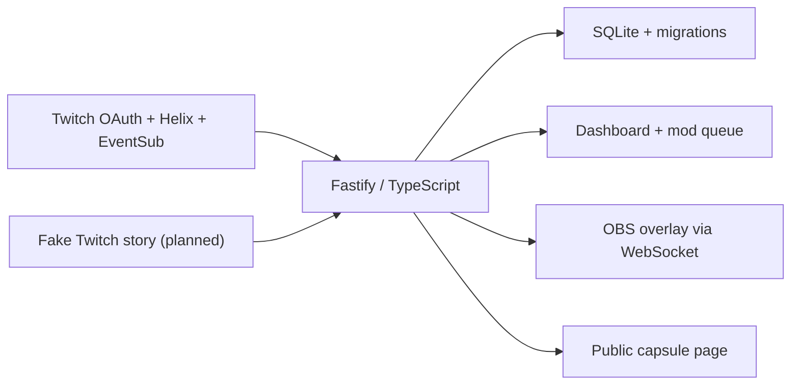

# Time Capsule

Time Capsule lets Twitch viewers seal free-text predictions and messages, then reveal them together during a future stream. A streamer can choose a date, a follower goal, a first stream in a category, or a manual opening. Moderators approve reveals; predictions that come true earn a place on the Wall of Prophets, with optional temporary VIP. The OBS overlay stays empty and transparent outside a ceremony. No paid AI or external AI service is used at runtime.

## Build status

**Phase 7: Prophets and VIP rewards.** Revealed predictions can be marked true in the private dashboard. The overlay stamps them, chat announces recognition, and optional VIP rewards include visible errors, retries, and an expiry job. Opened public capsules show a Wall of Prophets using display names only. No sealed or revealed message text is published by the public page. The original specification is in [CODEX_PROMPT.md](./CODEX_PROMPT.md).

## Quick start

Use Node.js 20.19+ (Node 24 recommended) and npm. Run these commands from the project root:

```sh
npm ci
npm test
npm run dev
```

Open [http://localhost:3000/health](http://localhost:3000/health). Expected JSON:

```json
{ "status": "ok", "app": "time-capsule", "phase": 7, "database": "ok" }
```

The health server and dashboard start without Twitch credentials and show a setup warning. A fresh start creates data/time-capsule.db and two different random keys in data/keys.json. Open the private dashboard URL printed at startup. The overlay URL is also printed at startup.

### This WSL workspace

This machine initially had no Linux Node executable. A checksum-verified Linux Node 24 runtime is installed inside the ignored .tools/node directory. In each new WSL terminal:

```sh
cd ~/hackathon_projects/time-capsule
export PATH="$PWD/.tools/node/bin:$PATH"
npm run dev
```

Use Linux npm inside WSL rather than a Windows npm installation. The runtime and cache stay local to this project and are not committed. On a fresh clone, install Node normally before following Quick start. If starting a second server, stop the existing development server first to free port 3000.

## Commands

| Command           | Purpose                                                    |
| ----------------- | ---------------------------------------------------------- |
| npm run dev       | Watch TypeScript and restart the health server             |
| npm run build     | Compile strict TypeScript into dist/                       |
| npm start         | Run the compiled server (build first)                      |
| npm test          | Run Vitest once                                            |
| npm run typecheck | Check application and test TypeScript                      |
| npm run lint      | Run ESLint and Prettier checks                             |
| npm run format    | Apply Prettier formatting                                  |
| npm run demo      | Reserved for Phase 8; currently exits with a clear message |

For a production-style check, stop the dev server, run npm run build, then npm start. Press Ctrl+C to stop either server cleanly.

## Configuration and storage

Copy .env.example to .env with your editor when needed. Every currently supported variable is documented there. Configuration is validated with Zod before listening; invalid ports, short keys, incomplete Twitch credential pairs, and mismatched callback origins fail with a clear error without printing supplied secret values. Explicit environment variables override .env values.

The default interface is 127.0.0.1 and port 3000. DATA_DIR resolves relative to the project root, so development and compiled runs use the same database. ADMIN_KEY and OVERLAY_KEY can override generated keys, must each have at least 32 characters, and must differ. Persisted keys are reused on restart. Losing keys invalidates future bookmarked private URLs.

SQLite uses foreign keys, WAL, a five-second busy timeout, and numbered migrations recorded transactionally in schema_migrations. The initial schema defines capsules, seals, prophets, and the event log, including database constraints for one sealing capsule and unique per-capsule seal numbers. Seal acceptance uses an IMMEDIATE transaction for numbering, duplicate checks, cooldowns, and per-user limits. Migration 2 records capsule channel identity so account changes cannot redirect new seals into another channel's capsule. Migration 3 adds durable opening deadlines and postponements, plus a unique constraint allowing only one opening at a time. Existing capsules and seals are preserved.

.env, data/, .tools/, .tmp/, node_modules/, and dist/ are ignored by Git. Keep local database and key backups private. Tests create and remove temporary storage under this project's .tmp/ directory.

## Architecture



src/config.ts loads settings and private keys. src/server.ts builds a testable server; src/index.ts starts it and handles shutdown. src/db/ owns schema migrations and database setup. src/twitch/auth.ts owns OAuth state, private tokens, validation, and refresh. src/twitch/helix.ts handles authenticated requests and bounded rate-limit retries. src/twitch/connection.ts maintains dashboard status and the hourly job. src/capsule/triggers.ts contains the pure state transition function; src/capsule/scheduler.ts owns polling, verified Twitch facts, and deadlines. public/dashboard/ contains dependency-free HTML, CSS, and JavaScript.

## Dependencies

Runtime dependencies are Fastify (HTTP server and request/response validation), better-sqlite3 (local transactional SQLite), dotenv (.env loading), and Zod (typed startup validation). Phase 3 adds ws (the Twitch EventSub client) and @fastify/websocket (authenticated live dashboard snapshots).

Development dependencies are TypeScript (strict compiler), tsx (development runner), Vitest (tests), ESLint with typescript-eslint and @eslint/js (lint), Prettier (format checks), and Node/SQLite/WebSocket type definitions. No frontend framework or AI service is included.

## Connect real Twitch accounts (Phase 2)

1. Register an application at [Twitch Developer Console](https://dev.twitch.tv/console/apps). Enable 2FA on your streamer account first. Choose category **Chat Bot**, client type **Confidential**, and the exact redirect URL **http://localhost:3000/auth/callback**.
2. Copy .env.example to .env with your editor. Set TWITCH_CLIENT_ID and TWITCH_CLIENT_SECRET locally. Never paste the secret into chat or commit it. Restart the server after editing .env.
3. Run npm run dev, then open the complete **Dashboard:** URL printed in the terminal. It contains the admin key; keep the link private. Using 127.0.0.1 in place of localhost changes the browser origin, so use the printed localhost URL.
4. Click **Connect streamer account**, sign in to your broadcaster account on Twitch, and approve the requested permissions. After the callback, the dashboard should show the account name, connected status, scopes, token expiry, and live/offline state.
5. Optional separate bot: sign in to the bot account on Twitch before clicking **Connect bot account**. The authorization screen forces confirmation; check which account you are authorizing. Streamer and bot must be different accounts. With no separate bot, the app uses the streamer token for chat and moderation.
6. For a separate bot, type /mod BOT_LOGIN in your own channel chat. Click **Recheck connection**. The red instruction banner disappears and Chat moderation shows **Ready to moderate**. If the bot is already a moderator, it passes immediately.
7. Stop and restart the app. It reloads private tokens, validates them, and restores the same account names without another login. **Disconnect locally** removes that role's stored tokens; it does not revoke the app on Twitch. To revoke access on Twitch too, use your Twitch account's Connections settings.

If changing the port/origin, update PORT, BASE_URL, TWITCH_REDIRECT_URI, and the registered Twitch redirect URL together. TWITCH_REDIRECT_URI must be BASE_URL + /auth/callback. Configuration is optional until you connect; an incomplete credential pair fails startup. A corrupt token file produces a clear startup error rather than silently overwriting credentials.

### Phase 2 acceptance check

- Without keys, /dashboard and /api/connection return 401.
- Connect the streamer and bot, verify their names, and verify the moderator banner before/after /mod.
- Test single-account mode by disconnecting the bot locally: streamer stays connected and moderation remains ready.
- Cancel a new OAuth consent flow: the dashboard shows the cancellation notice.
- Restart and verify persisted connections. Tokens are checked at startup and hourly; expired access tokens are refreshed before API use or after a 401. Revoked refresh tokens are removed locally and require reconnection. Network failures retain credentials and show an error so you can recheck.
- Run npm test, npm run typecheck, npm run lint, and npm run build. Tests use fake Twitch HTTP responses and do not need accounts or secrets. The Twitch consent screen and actual account permissions still need this real-account acceptance check.

### API and OAuth inventory

| Service | Endpoint                                                  | Why                                                                                                                    |
| ------- | --------------------------------------------------------- | ---------------------------------------------------------------------------------------------------------------------- |
| OAuth   | GET https://id.twitch.tv/oauth2/authorize                 | Authorization code consent with random, expiring, single-use state and an HttpOnly SameSite=Lax browser-binding cookie |
| OAuth   | POST https://id.twitch.tv/oauth2/token                    | Code exchange and refresh; credentials and URL-encoded refresh tokens are sent in the request body                     |
| OAuth   | GET https://id.twitch.tv/oauth2/validate                  | Verify client ID, user identity, scopes, and expiry at startup and hourly                                              |
| Helix   | GET /helix/users (optionally ?login=)                     | Retrieve account identity and display name                                                                             |
| Helix   | GET /helix/moderation/moderators?broadcaster_id=&user_id= | Verify the separate bot is a moderator, using the broadcaster token                                                    |
| Helix   | GET /helix/streams?user_id=                               | Show live/offline state                                                                                                |

Streamer scopes: channel:manage:vips, moderator:read:followers, moderation:read, user:read:chat, user:write:chat, moderator:manage:chat_messages. Bot scopes: user:read:chat, user:write:chat, moderator:manage:chat_messages.

**Specification correction:** the streamer also requests moderator:manage:chat_messages so single-account mode can delete viewer seals in Phase 4. The original scope list omitted it, but [Twitch requires it for Delete Chat Messages](https://dev.twitch.tv/docs/api/reference/#delete-chat-messages). Phase 4 adds !seal and chat deletion; no VIP actions occur yet.

Tokens are stored atomically in gitignored data/tokens.json with owner-only permissions on systems that support POSIX modes. Refresh operations are shared per role so concurrent 401s do not rotate the same refresh token repeatedly. Helix sends both Client-Id and Bearer headers, honors Ratelimit-Reset with at most two retries, and surfaces waits beyond 60 seconds for manual retry. Requests have a 10-second timeout. No raw Twitch error bodies, authorization codes, keys, or tokens are written to request logs.

The dashboard document requires its query key. API access requires the x-admin-key header, and state-changing API requests reject foreign browser origins. The two dashboard CSS/JS assets are public and contain no private data. All dashboard account and warning text uses textContent, with a restrictive Content Security Policy and no remote fonts, scripts, or analytics.

Official references: [Authorization code flow](https://dev.twitch.tv/docs/authentication/getting-tokens-oauth/#authorization-code-grant-flow), [Token refresh](https://dev.twitch.tv/docs/authentication/refresh-tokens/), [Required token validation](https://dev.twitch.tv/docs/authentication/validate-tokens/), [Helix reference](https://dev.twitch.tv/docs/api/reference/), [Rate limits](https://dev.twitch.tv/docs/api/guide/#twitch-rate-limits).

## EventSub and chat (Phase 3)

The app automatically connects after startup token validation or account connection. A streamer-only setup uses one WebSocket with all five subscriptions. With a separate bot, the streamer connection owns stream/category/follow subscriptions and the bot connection owns chat. Every subscription is created using the token belonging to that connection's user.

| EventSub type        | Version | Condition                                                  |
| -------------------- | ------- | ---------------------------------------------------------- |
| stream.online        | 1       | broadcaster_user_id                                        |
| stream.offline       | 1       | broadcaster_user_id                                        |
| channel.update       | 2       | broadcaster_user_id                                        |
| channel.follow       | 2       | broadcaster_user_id and moderator_user_id = broadcaster ID |
| channel.chat.message | 1       | broadcaster_user_id and user_id = bot or streamer ID       |

After session_welcome, subscriptions are requested concurrently to meet Twitch's default ten-second initial subscription window. Notifications and keepalives reset the watchdog. Its initial window is armed again after subscription setup, with a bounded delivery margin (10% of the interval, at most one second) so a keepalive at the interval boundary does not cause reconnect churn. An ordinary disconnect reconnects with bounded backoff and resubscribes. For session_reconnect, the old socket stays open until the new welcome; subscriptions are preserved and are not recreated. Reconnect URLs are accepted only on the configured Twitch WebSocket origin. Revocation and subscription failures appear in dashboard warnings and the activity log; use Recheck connection after fixing permissions.

EventSub delivery IDs are deduplicated across socket handovers and ordinary reconnects. Chat message IDs are deduplicated separately. Both in-memory caches retain at most 5000 IDs for up to ten minutes. Notifications must match an expected subscription type, version, and condition. No events lost during an ordinary disconnect can be replayed by Twitch.

The dashboard connects to /ws/dashboard using its private key and configured browser origin. It restores a fresh snapshot after reconnecting, with HTTP polling as fallback. Open Event subscriptions & keepalive to inspect each account's subscriptions and last keepalive. The Channel activity section shows the newest 100 events; SQLite retains at most 1000 log entries. Logs redact known credentials and omit !seal contents. Normal chat text is stored in this private debug log. Sealed-message storage is implemented in Phase 4 and is excluded from this event log.

### Phase 3 acceptance check

1. Run npm run dev and refresh the private dashboard URL printed at startup.
2. With the connected streamer, EVENTSUB should become Connected. Expand Event subscriptions & keepalive: single-account mode should show five enabled subscriptions and a keepalive timestamp shortly afterward.
3. Send a normal message in the channel's Twitch chat. It should appear in Channel activity without refreshing the page.
4. **For single-account mode, send !capsule from a different viewer account.** The app ignores commands from its own sender account to prevent loops. With a separate bot, the streamer can send the command. Expected reply: No capsule is open for sealing right now.
5. Repeat !capsule within 30 seconds: no extra reply. Try again after 30 seconds: a new reply is sent.
6. Restart the server and refresh the dashboard: account authorization is restored, subscriptions reconnect, and recent log entries remain.
7. Run npm test, npm run typecheck, npm run lint, and npm run build. EventSub tests use a real local fake WebSocket server and fake Helix HTTP responses. No Twitch credentials are used by tests.

Chat uses POST /helix/chat/messages with broadcaster_id, sender_id, and message, authenticated as the effective bot user. Messages are limited to 500 Unicode code points and sent through a queue with at least 1.5 seconds between attempts. !capsule has a channel-wide 30-second cooldown. Failed or dropped sends are reported visibly; account changes cancel queued replies. Replies made with user tokens follow Twitch's shared-chat delivery behavior.

Official references: [WebSocket lifecycle and limits](https://dev.twitch.tv/docs/eventsub/handling-websocket-events/), [Subscription types](https://dev.twitch.tv/docs/eventsub/eventsub-subscription-types/), [Create EventSub Subscription](https://dev.twitch.tv/docs/api/reference/#create-eventsub-subscription), [Send Chat Message](https://dev.twitch.tv/docs/api/reference/#send-chat-message).

The exact Twitch CLI mock-server commands will be checked and documented in Phase 8, as specified in the build plan. The automated Phase 3 suite exercises the real ws client locally without the CLI.

## Capsule creation and sealing (Phase 4)

In the dashboard's Capsules section, choose a title and an opening condition: manual, date, follower goal, or first stream in a Twitch category. Date inputs use your browser's local time and are stored as ISO timestamps. Category search uses GET /helix/search/categories and stores both the chosen ID and display name. The Phase 5 trigger engine compares the ID; display names never determine readiness.

Limits default to three seals per viewer, 280 Unicode code points per message, and a ten-second cooldown. You can set a per-user limit from 1 to 100 and a maximum length from 3 to 280. VIP reward preferences and days are stored for Phase 7; they do not grant VIP yet. Only one capsule may be sealing at a time, enforced by SQLite and the create route. Locking stops new seals and frees the active slot; archiving preserves all stored seals.

Each capsule records its broadcaster ID, login, and display name. New seals must come from that channel. The private list can show capsules from a previously connected channel so you can lock/archive them before changing channels. !capsule describes the active or latest non-archived capsule for the current channel, including count, opening condition/countdown, and public URL. Moderator/broadcaster badges authorize !capsule lock, !capsule open, and !capsule status; VIP alone does not. Own-sender commands remain ignored in single-account mode, so use dashboard controls or another moderator account.

### What happens to !seal

1. Validate an active capsule, 3-to-configured-maximum Unicode length, whole-word blocked terms, per-user limit, and ten-second cooldown.
2. In one IMMEDIATE SQLite transaction, check duplicate Twitch message IDs and assign the next unique number for that capsule. Rejected seals are not stored.
3. Delete exactly that Twitch message using DELETE /helix/moderation/chat with broadcaster_id, moderator_id, and message_id. The app never calls this endpoint without a specific message ID, since omitting it would clear the chat.
4. Store hidden=true only after Twitch returns success. Moderator/broadcaster messages are stored with hidden=false without attempting a deletion Twitch forbids. Other deletion errors preserve the seal and show a dashboard warning.
5. Combine acknowledgements over a three-second window. A single accepted viewer message gets Sealed message #N from @user. Opens: ...; a burst gets an accurate number range and combined names. Replies retain their original channel/sender context, so account changes cancel them rather than sending to another channel. Rejections are grouped and limited to one per user per ten seconds to avoid repeated error spam.

The blocked-word file is data/blocked-words.txt (gitignored, created on startup). Add one word or phrase per line; # starts a comment. Matching is case-insensitive and respects Unicode word boundaries, so a blocked bad does not reject badminton. Edits reload automatically. An unreadable or oversized file causes seals to be rejected visibly instead of silently bypassing moderation.

### Public capsule pages

View public page opens /c/:slug. The page and /api/public/capsules/:slug expose only whitelisted capsule/channel metadata, configured limits, condition, and sealed count. They never expose viewer IDs, logins, display names, hidden flags, or sealed texts. The count refreshes every five seconds; date capsules show a live countdown. Public pages are unauthenticated but the server still binds to 127.0.0.1, so sharing outside this computer needs a separately configured hosting/tunnel arrangement.

Twitch messages may briefly be seen before deletion; broadcaster/moderator messages cannot be hidden at all. The dashboard shows how many stored messages are not hidden. This is chat message deletion rather than encryption or a guarantee that nobody saw the original message. The pre-opening public page stays private with respect to contents.

### Phase 4 acceptance check

1. Start npm run dev if necessary and refresh the private dashboard. Create a capsule titled Test predictions with When I choose as its opening condition.
2. From your viewer account (romil100 in your current setup), send !seal The next boss will be a dragon in the channel chat.
3. The original message should disappear, the dashboard count should increase, and within about three seconds romilg16 should acknowledge seal #1. Chat send spacing may add a short delay during bursts.
4. Open View public page. It should show the title, condition, and count; it must not show the sealed message or viewer identity. Copy public link should copy that public URL.
5. Immediately send another !seal: expect a short cooldown reply and no new stored seal. After ten seconds, send again. The default third seal is allowed; the fourth gets the per-user limit reply.
6. Add a test word to data/blocked-words.txt, then send it from a viewer with remaining allowance: expect rejection and no count increase. Remove the test word afterward.
7. Lock sealing from the dashboard. Another !seal should get No capsule is open for sealing right now. Counts remain intact, and you can create another capsule starting at seal #1.
8. Test moderator-message handling using a moderator account distinct from the bot: the seal is stored, the message stays in chat, and the bot explains the limitation.
9. Run npm test, npm run typecheck, npm run lint, and npm run build. The automated suite covers parsing, Unicode limits/blocked words, cooldown/limits, sequential numbering under overlapping callbacks, restart idempotency, batching, exact-message deletion, visibility failures, channel ownership, public-data privacy, and XSS-safe rendering.

Official references: [Delete Chat Messages](https://dev.twitch.tv/docs/api/reference/#delete-chat-messages), [Search Categories](https://dev.twitch.tv/docs/api/reference/#search-categories).

## Opening triggers (Phase 5)

A waiting capsule moves from sealing/locked to **ready** once its condition is met. Readiness stops new seals. It becomes **opening** only while live:

| Trigger   | How it is checked                                                                                                    |
| --------- | -------------------------------------------------------------------------------------------------------------------- |
| Date      | Every 30 seconds, also on startup and connection recheck                                                             |
| Followers | Authoritative Helix total at startup, on channel.follow, and every 5 minutes                                         |
| Category  | Matching category **ID** while live, checked at startup, on channel.update, and on stream.online using GET /channels |
| Manual    | Dashboard **Open now** or moderator **!capsule open**                                                                |

When a condition is reached during a live stream, opening waits 5 seconds. A capsule made ready offline stays ready until the next live stream, then waits OFFLINE_OPEN_DELAY_SECONDS (60 by default). A lost/offline/unknown live state cancels the countdown. The scheduler also checks Helix live status at the deadline so a missed offline event cannot open a capsule while offline.

**Postpone 10 min** keeps the original condition and saves a ten-minute opening delay. Before the condition is reached, sealing can continue. Once ready, the capsule stays ready during the postponement. Restarting the app preserves the postponement and all seals, verifies current Twitch facts, and starts a fresh live settling delay where necessary. **Open now** overrides both the condition and postponement, waits five seconds if live, or waits for the next live stream if offline. It always respects the live requirement.

Opening controls are shown for sealing, locked, and ready capsules. Archive can cancel a ready capsule. Once opening starts, use the Phase 6 ceremony controls to approve, reveal, and end. Other ready capsules wait their turn. This phase never reveals message text.

The dashboard shows current follower totals, category, live state, opening time, postponement, and errors. The public page adds the current follower total for follower goals while keeping viewer identities and sealed contents private. The three new fields readyAt, openingDueAt, and postponedUntil are private dashboard metadata.

### Phase 5 acceptance check

The development server runs with the same saved accounts, database, dashboard key, and public links. Refresh the dashboard at the private URL printed at startup. If starting it manually in this WSL workspace:

```sh
cd ~/hackathon_projects/time-capsule
export PATH="$PWD/.tools/node/bin:$PATH"
npm run dev
```

1. For an offline check, use a manual capsule and click **Open now**. Expect **READY**, a waiting-for-live message, and the same sealed count. Click **Postpone 10 min** and confirm a saved time appears. Reload the page: the postponement remains. Open now clears it.
2. For the category acceptance test, lock the existing sealing capsule first (keeps its messages), then create a capsule with the **first stream in category** condition. Search and select a category that differs from your current stream category.
3. Go live in the other category; this capsule must stay sealing. Change the Twitch stream category to the selected one. Expect **READY**, then **OPENING** after about five seconds. Changing the category while offline does not trigger it.
4. To test an offline-ready delay, make a manual/date/follower capsule ready while offline, then go live. Expect it to wait the configured 60 seconds. Postpone before its deadline to delay it.
5. Test moderator **!capsule open** with a moderator account different from the effective sending account. Ordinary viewers and VIPs cannot use it. In single-account mode, use the dashboard: the streamer's own chat commands are ignored to prevent loops.
6. The public page must continue to show counts and no sealed contents. At OPENING it says the opening has started. Use the ceremony section for approvals and reveals.

For fast, account-free automated acceptance checks, run `npm test -- test/triggers.test.ts test/scheduler.test.ts test/trigger-routes.test.ts`. These use fake Twitch HTTP and a real local mock EventSub WebSocket server to cover category IDs, all trigger types, timing, permissions, missed offline events, event/snapshot races, postponement persistence, and privacy.

New private controls: POST /api/capsules/:id/open and POST /api/capsules/:id/postpone. They require the same admin key and browser-origin checks as other mutations. Both require this capsule's streamer account to be connected. GET /api/connection and dashboard WebSocket snapshots include trigger facts and warnings.

New Helix reads use the streamer user token: [Get Channel Information](https://dev.twitch.tv/docs/api/reference/#get-channel-information) supplies game_id/game_name and [Get Channel Followers](https://dev.twitch.tv/docs/api/reference/#get-channel-followers) supplies total. Only the total is retained; no follower list is stored. Existing moderator:read:followers consent covers the follower endpoint; no new dependencies or scopes are added.

## Ceremony and OBS overlay (Phase 6)

When the trigger engine moves a capsule to opening, the server starts a six-second opening animation, then waits in the moderation queue. The overlay shows only a small corner header while waiting. Each Reveal next action takes the lowest-numbered approved message, marks it revealed, and sends it to the overlay. Pending and rejected messages are never sent to OBS. The three newest cards stay visible; older ones slide away. End ceremony fades the overlay to empty and sets the capsule to opened.

The ceremony state, most recent revealed card IDs, approvals, timestamps, side, card size, and auto-reveal interval are saved in SQLite by migration 4. Reloading OBS or reconnecting its WebSocket restores the current stage and revealed cards. Restarting resumes the ceremony and any enabled auto-reveal, using approved messages only. No catch-up burst is played. If the app starts with an opening capsule left by Phase 5, it adopts that capsule and starts its ceremony; an empty capsule can be ended immediately.

### Add the overlay in OBS

1. Run the app, open the private dashboard URL printed at startup, and find **Your OBS overlay**.
2. Click **Copy OBS URL**. It is http://localhost:3000/overlay?key= followed by your private OVERLAY_KEY, also printed at startup.
3. In OBS, choose **Sources → + → Browser**, name it Time Capsule, and paste the URL. Place this source **above** your game/window capture.
4. Set Width **1920** and Height **1080**. Keep **Shutdown source when not visible** OFF and **Refresh browser source when scene becomes active** OFF. Default transparent Custom CSS can stay as it is.
5. Click **Play 10-second preview** in the dashboard. It plays an opening and sample cards, then returns to a completely empty overlay. You do not need to go live for the preview.
6. The dashboard's optional **Show overlay monitor** displays the same view on a checkerboard. The checkerboard belongs to the dashboard; it is not included in the OBS page.

The source is fully transparent with no rendered content outside a ceremony. The opening uses CSS gold capsule halves and light rays; reduced-motion preferences disable animation. Message contents and display names use textContent exclusively. A lost connection hides old overlay content until a fresh snapshot arrives. The OBS page needs its overlay key; WebSocket upgrades also require the configured origin. That key cannot approve messages or access the dashboard.

See the official [OBS Browser Source properties](https://obsproject.com/kb/browser-source) for URL, viewport, transparency, shutdown, and refresh settings.

### Moderation and reveal controls

The private queue is available while a ceremony is active. Filter by pending, approved, rejected, revealed, or all, with pages of 50 messages. A flagged label identifies matches against the current blocked-word file, including terms added after the seal was stored. Flagging does not approve or reveal anything; the moderator decides whether to approve or reject it. Revealed messages cannot be changed back to another status.

- **Reveal next · N** reveals only the next approved message. The N hotkey is ignored while typing, using modifier keys, or holding the key down.
- **Start auto-reveal** uses the saved 3–60 second interval and pauses when no approved messages remain.
- **Card side** can be left or right; **Card size** can be 85%, 100%, or 115%.
- **End ceremony** stops auto-reveal, clears the overlay, and preserves all messages and decisions.
- **Play 10-second preview** uses sample messages in memory only. It does not touch real seals, approvals, Twitch chat, or capsule status. End an active real ceremony before previewing.

Public capsule pages remain metadata and counts only, including after a ceremony ends. Revealed text is available through the private dashboard and keyed OBS view. Public message publication remains disabled. Phase 7 adds Prophet stamps, VIP actions, and a name-only public wall.

### Phase 6 acceptance check

1. Refresh the dashboard. If the old zero-message GTA 6 capsule is still opening/queued, click **End ceremony** first.
2. Add the OBS Browser Source using the steps above. Before preview or a ceremony, your underlying capture should remain fully visible.
3. Click **Play 10-second preview**. Expect the gold opening, sample cards, and then an empty overlay. This works offline. Check left/right, size, and reduced-motion behavior if desired.
4. For a real reveal, create a new manual capsule. From a viewer account distinct from the sending account, send a few !seal messages. Confirm deletion and the sealed count before opening it.
5. While the channel is live, click **Open now**. After the five-second trigger delay and six-second opening, the private queue appears. Approve one message, reject another, and click **Reveal next** or press N. Only the approved message should appear on OBS.
6. Approve several more, save an auto-reveal interval, and start auto-reveal. The newest three cards stay on the selected side. The rejected message must never appear.
7. Refresh the OBS Browser Source or reopen its private URL. The same revealed cards return. End the ceremony: all overlay content fades out and the capsule becomes opened.
8. Run npm test, npm run typecheck, npm run lint, and npm run build. Tests cover invalid transitions, moderation ownership, approval gates, auto-reveal, restart persistence, preview isolation, keyed WebSockets, reconnect restoration, transparent idle rendering, and hostile viewer text.

Private HTTP routes: GET /api/ceremony, GET /api/ceremony/queue, POST /api/ceremony/seals/:id, POST /api/ceremony/reveal, POST /api/ceremony/auto, POST /api/ceremony/settings, POST /api/ceremony/end, and POST /api/ceremony/preview. They use existing dashboard authentication and mutation origin checks. The read-only overlay uses /overlay, /api/overlay/state, and /ws/overlay with its separate overlay key. No new dependencies, Twitch scopes, or Twitch API endpoints are added in Phase 6.

## Prophets and VIP rewards (Phase 7)

The private **Prophets** section lists revealed predictions, including after the ceremony ends. **Came true** permanently marks a prediction, updates its visible overlay card during the active ceremony, and sends `@user's prediction came true. Prophet!` through the existing chat sender. A granted reward adds the VIP duration to that announcement. Duplicate clicks create one Prophet record and one confirmed announcement. If chat fails, the dashboard explains the failure and offers **Retry announcement**. Check chat before retrying an unconfirmed send: an interrupted response may have delivered the message.

When creating a capsule, enable **Reward Prophets with VIP** and choose 1–365 days (default 30). Rewards are off by default. A revealed prediction from a VIP-enabled capsule attempts the grant when marked true. The green CAME TRUE stamp and gold PROPHET badge appear even when Twitch refuses VIP. The overlay banner says a VIP was granted only after confirmation; otherwise it shows recognition and directs you to the dashboard. Recognition remains after VIP expires. The sample ten-second preview now includes a Prophet stamp at the end; it never calls Twitch.

VIP reads and changes use the broadcaster's user token and the existing `channel:manage:vips` scope. The implementation adds [Get VIPs](https://dev.twitch.tv/docs/api/reference/#get-vips), [Add Channel VIP](https://dev.twitch.tv/docs/api/reference/#add-channel-vip), and [Remove Channel VIP](https://dev.twitch.tv/docs/api/reference/#remove-channel-vip). It first checks the specific viewer's current role. Existing VIPs are preserved and get no app-owned expiry. Grant errors explain invalid IDs, authorization, unavailable users, no free slots, moderator/already-VIP conflicts, channel eligibility, and rate limits. Removal also handles permission errors and an already-removed VIP. No new scopes or dependencies are required.

Migration 5 adds reward/announcement status and a separate ownership ledger. Only a confirmed successful app grant creates an owned VIP award. Multiple rewards for the same viewer/channel share ownership and extend expiry to the latest reward; the role is removed once. At startup and every hour, the job removes expired owned awards using their original channel identity. Failed removals appear on the reward; use **Check expired VIP rewards** to retry. If the original channel is disconnected, reconnect it first. The app must be running to process expiry; overdue confirmed awards are checked on the next startup.

An interrupted grant/removal is recorded as uncertain rather than guessed successful. A grant retry checks Twitch first and preserves any existing role. An uncertain removal pauses automatic removal and needs review in Twitch. The ledger cannot distinguish a manually removed-and-regranted role from the original app grant between checks; manage such changes in Twitch with the recorded expiry in mind. Local database and token backups must remain private.

After **End ceremony**, the public page shows up to 100 Prophet display names, with each viewer's count of correct predictions. Pending/rejected messages, seal texts, user IDs, role errors, and VIP expiry details remain private. This implements the public Wall of Prophets without enabling public message publication.

### Phase 7 acceptance check

1. Refresh your existing private dashboard at localhost:3000. The **Prophets** section appears between the ceremony and overlay sections. Existing capsules, keys, accounts, and sealed messages are preserved.
2. Click **Play 10-second preview**. At the end of the sample cards, expect a CAME TRUE stamp and PROPHET badge. The preview returns to an empty overlay and needs no live stream.
3. For the real flow, create a manual capsule with VIP **off** first. Have a separate viewer send `!seal I predict we win the next round` in Twitch chat. Go live, choose **Open now**, approve the message, then **Reveal next**.
4. In **Prophets**, click **Came true** for that revealed message. Expect the overlay stamp/banner and the Prophet chat announcement. Reload the dashboard: the recognition remains. A pending or rejected seal cannot be marked true.
5. For VIP, create a new capsule with **Reward Prophets with VIP** enabled before collecting its seals. Repeat the approved reveal and Came true flow. Expect either **VIP granted by this app** with an expiry, or a clear Twitch error. Your channel may require Build a Community and a free VIP slot. Existing VIPs are preserved. Use **Retry VIP** after resolving a grant error.
6. End the ceremony. The overlay fades to empty. Open **View public page**: the Wall of Prophets shows display names without message contents or private role details.
7. Run `npm test`, `npm run typecheck`, `npm run lint`, and `npm run build`. Fake Twitch tests cover grant/removal errors, permission isolation, concurrent clicks, existing roles, overlapping awards, restarts, startup/hourly expiry, retry behavior, public privacy, and literal-text rendering. Live Twitch grants are left for your acceptance test.

Private routes: GET /api/prophets (50-row pages, limit capped at 100), POST /api/prophets/seals/:id/came-true, POST /api/prophets/seals/:id/retry-vip, POST /api/prophets/seals/:id/retry-chat, and POST /api/prophets/expiry. All require the admin key; browser mutations also check Origin. The overlay key cannot use these routes. `src/capsule/prophets.ts` owns persistence and expiry; ceremony state and rendering remain separate.

## Next phase

Phase 8 adds an account-free demo mode and Play full story. It has not been started.

## How I used Codex

TODO for the project owner: describe your build process and add the session ID of the chat where most of the build happened.

## Remaining release work

Ceremony screenshot/GIF, full demo quick start, complete Twitch setup and API inventory, accessibility review, and final fresh-clone verification are tracked by Phases 8-9 of CODEX_PROMPT.md.

Planned operational limitations: the app must be running to catch Twitch events; Twitch cannot hide the broadcaster's or moderators' messages; VIP depends on channel eligibility and available slots.

## License

MIT. See [LICENSE](./LICENSE).
