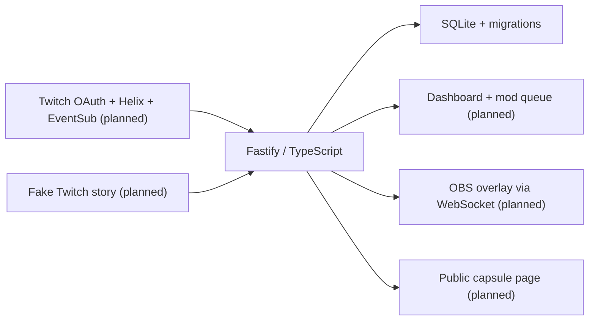

# Time Capsule

Time Capsule lets Twitch viewers seal free-text predictions and messages, then reveal them together during a future stream. A streamer can choose a date, a follower goal, a first stream in a category, or a manual opening. Moderators approve reveals; predictions that come true earn a place on the Wall of Prophets, with optional temporary VIP. The planned OBS overlay stays empty and transparent outside a ceremony. No paid AI or external AI service is used at runtime.

## Build status

**Phase 1: skeleton.** The working feature is a local Fastify health endpoint backed by a migrated SQLite database. Twitch connection, chat commands, dashboard, public pages, ceremony, VIP, and the story demo arrive in Phases 2-8. The original specification is in [CODEX_PROMPT.md](./CODEX_PROMPT.md).

## Quick start

Use Node.js 20.19+ (Node 24 recommended) and npm. Run these commands from the project root:

```sh
npm ci
npm test
npm run dev
```

Open [http://localhost:3000/health](http://localhost:3000/health). Expected JSON:

```json
{ "status": "ok", "app": "time-capsule", "phase": 1, "database": "ok" }
```

No Twitch account, credentials, or .env file is needed for Phase 1. A fresh start creates data/time-capsule.db and two different random keys in data/keys.json. The keys are reserved for the dashboard and overlay in later phases; those routes do not exist yet.

### This WSL workspace

This machine initially had no Linux Node executable. A checksum-verified Linux Node 24 runtime is installed inside the ignored .tools/node directory. In each new WSL terminal:

```sh
cd ~/hackathon_projects/time-capsule
export PATH="$PWD/.tools/node/bin:$PATH"
npm run dev
```

Use Linux npm inside WSL rather than a Windows npm installation. The runtime and cache stay local to this project and are not committed. On a fresh clone, install Node normally before following Quick start.

## Commands

| Command           | Purpose                                                    |
| ----------------- | ---------------------------------------------------------- |
| npm run dev       | Watch TypeScript and restart the health server             |
| npm run build     | Compile strict TypeScript into dist/                       |
| npm start         | Run the compiled server (build first)                      |
| npm test          | Run Vitest once                                            |
| npm run typecheck | Check application and test TypeScript                      |
| npm run lint      | Run ESLint and Prettier checks                             |
| npm run format    | Apply Prettier formatting                                  |
| npm run demo      | Reserved for Phase 8; currently exits with a clear message |

For a production-style check, stop the dev server, run npm run build, then npm start. Press Ctrl+C to stop either server cleanly.

## Configuration and storage

Copy .env.example to .env with your editor when needed. Every currently supported variable is documented there. Configuration is validated with Zod before listening; invalid ports, short keys, and incomplete Twitch credential pairs fail with a clear error without printing supplied secret values. Explicit environment variables override .env values.

The default interface is 127.0.0.1 and port 3000. DATA_DIR resolves relative to the project root, so development and compiled runs use the same database. ADMIN_KEY and OVERLAY_KEY can override generated keys, must each have at least 32 characters, and must differ. Persisted keys are reused on restart. Losing keys invalidates future bookmarked private URLs.

SQLite uses foreign keys, WAL, a five-second busy timeout, and numbered migrations recorded transactionally in schema_migrations. The initial schema defines capsules, seals, prophets, and the event log, including database constraints for one sealing capsule and unique per-capsule seal numbers. Chat insertion transactions will be implemented in Phase 4.

.env, data/, .tools/, .tmp/, node_modules/, and dist/ are ignored by Git. Keep local database and key backups private. Tests create and remove temporary storage under this project's .tmp/ directory.

## Architecture



src/config.ts loads settings and private keys. src/server.ts builds a testable server; src/index.ts starts it and handles shutdown. src/db/ owns schema migrations and database setup. public/ reserves the page directories. test/ covers configuration, migrations, database constraints, persistence, and HTTP behavior.

## Dependencies

Runtime dependencies are Fastify (HTTP server and request/response validation), better-sqlite3 (local transactional SQLite), dotenv (.env loading), and Zod (typed startup validation). WebSocket libraries will be added when implemented, in Phase 3.

Development dependencies are TypeScript (strict compiler), tsx (development runner), Vitest (tests), ESLint with typescript-eslint and @eslint/js (lint), Prettier (format checks), and Node/SQLite type definitions. No frontend framework or AI service is included.

## Next phase: Twitch authentication

Register a confidential Twitch Chat Bot application with callback http://localhost:3000/auth/callback. Keep its Client Secret out of chat and Git. Phase 2 will add account connection and the bot moderator check. Twitch scopes, exact API usage, OBS setup, CLI integration, and the full story demo will be documented as those features are implemented and verified.

## How I used Codex

TODO for the project owner: describe your build process and add the session ID of the chat where most of the build happened.

## Remaining release work

Ceremony screenshot/GIF, full demo quick start, complete Twitch setup and API inventory, accessibility review, and final fresh-clone verification are tracked by Phases 8-9 of CODEX_PROMPT.md.

Planned operational limitations: the app must be running to catch Twitch events; Twitch cannot hide the broadcaster's or moderators' messages; VIP depends on channel eligibility and available slots.

## License

MIT. See [LICENSE](./LICENSE).
