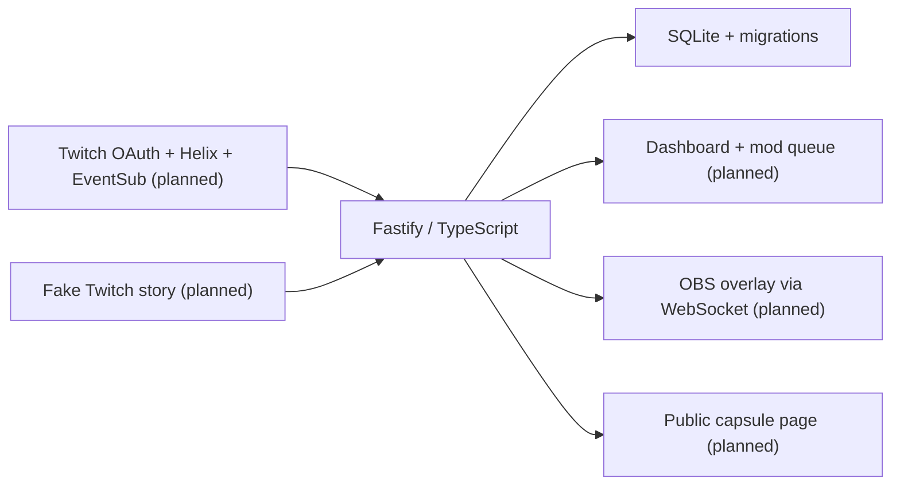

# Time Capsule

Time Capsule lets Twitch viewers seal free-text predictions and messages, then reveal them together during a future stream. A streamer can choose a date, a follower goal, a first stream in a category, or a manual opening. Moderators approve reveals; predictions that come true earn a place on the Wall of Prophets, with optional temporary VIP. The planned OBS overlay stays empty and transparent outside a ceremony. No paid AI or external AI service is used at runtime.

## Build status

**Phase 2: Twitch authentication and connection dashboard.** The app supports streamer and optional bot OAuth, private token persistence and rotation, startup/hourly validation, live status, and the bot moderator check. Chat listening, capsules, ceremony, VIP rewards, and the story demo arrive in Phases 3-8. The original specification is in [CODEX_PROMPT.md](./CODEX_PROMPT.md).

## Quick start

Use Node.js 20.19+ (Node 24 recommended) and npm. Run these commands from the project root:

```sh
npm ci
npm test
npm run dev
```

Open [http://localhost:3000/health](http://localhost:3000/health). Expected JSON:

```json
{ "status": "ok", "app": "time-capsule", "phase": 2, "database": "ok" }
```

The health server and dashboard start without Twitch credentials and show a setup warning. A fresh start creates data/time-capsule.db and two different random keys in data/keys.json. Open the private dashboard URL printed at startup. The overlay arrives in Phase 6.

### This WSL workspace

This machine initially had no Linux Node executable. A checksum-verified Linux Node 24 runtime is installed inside the ignored .tools/node directory. In each new WSL terminal:

```sh
cd ~/hackathon_projects/time-capsule
export PATH="$PWD/.tools/node/bin:$PATH"
npm run dev
```

Use Linux npm inside WSL rather than a Windows npm installation. The runtime and cache stay local to this project and are not committed. On a fresh clone, install Node normally before following Quick start. If starting a second server, stop the existing development server first to free port 3000.

## Commands

| Command           | Purpose                                                    |
| ----------------- | ---------------------------------------------------------- |
| npm run dev       | Watch TypeScript and restart the health server             |
| npm run build     | Compile strict TypeScript into dist/                       |
| npm start         | Run the compiled server (build first)                      |
| npm test          | Run Vitest once                                            |
| npm run typecheck | Check application and test TypeScript                      |
| npm run lint      | Run ESLint and Prettier checks                             |
| npm run format    | Apply Prettier formatting                                  |
| npm run demo      | Reserved for Phase 8; currently exits with a clear message |

For a production-style check, stop the dev server, run npm run build, then npm start. Press Ctrl+C to stop either server cleanly.

## Configuration and storage

Copy .env.example to .env with your editor when needed. Every currently supported variable is documented there. Configuration is validated with Zod before listening; invalid ports, short keys, incomplete Twitch credential pairs, and mismatched callback origins fail with a clear error without printing supplied secret values. Explicit environment variables override .env values.

The default interface is 127.0.0.1 and port 3000. DATA_DIR resolves relative to the project root, so development and compiled runs use the same database. ADMIN_KEY and OVERLAY_KEY can override generated keys, must each have at least 32 characters, and must differ. Persisted keys are reused on restart. Losing keys invalidates future bookmarked private URLs.

SQLite uses foreign keys, WAL, a five-second busy timeout, and numbered migrations recorded transactionally in schema_migrations. The initial schema defines capsules, seals, prophets, and the event log, including database constraints for one sealing capsule and unique per-capsule seal numbers. Chat insertion transactions will be implemented in Phase 4.

.env, data/, .tools/, .tmp/, node_modules/, and dist/ are ignored by Git. Keep local database and key backups private. Tests create and remove temporary storage under this project's .tmp/ directory.

## Architecture



src/config.ts loads settings and private keys. src/server.ts builds a testable server; src/index.ts starts it and handles shutdown. src/db/ owns schema migrations and database setup. src/twitch/auth.ts owns OAuth state, private tokens, validation, and refresh. src/twitch/helix.ts handles authenticated requests and bounded rate-limit retries. src/twitch/connection.ts maintains dashboard status and the hourly job. public/dashboard/ contains dependency-free HTML, CSS, and JavaScript.

## Dependencies

Runtime dependencies are Fastify (HTTP server and request/response validation), better-sqlite3 (local transactional SQLite), dotenv (.env loading), and Zod (typed startup validation). WebSocket libraries will be added when implemented, in Phase 3.

Development dependencies are TypeScript (strict compiler), tsx (development runner), Vitest (tests), ESLint with typescript-eslint and @eslint/js (lint), Prettier (format checks), and Node/SQLite type definitions. No frontend framework or AI service is included.

## Connect real Twitch accounts (Phase 2)

1. Register an application at [Twitch Developer Console](https://dev.twitch.tv/console/apps). Enable 2FA on your streamer account first. Choose category **Chat Bot**, client type **Confidential**, and the exact redirect URL **http://localhost:3000/auth/callback**.
2. Copy .env.example to .env with your editor. Set TWITCH_CLIENT_ID and TWITCH_CLIENT_SECRET locally. Never paste the secret into chat or commit it. Restart the server after editing .env.
3. Run npm run dev, then open the complete **Dashboard:** URL printed in the terminal. It contains the admin key; keep the link private. Using 127.0.0.1 in place of localhost changes the browser origin, so use the printed localhost URL.
4. Click **Connect streamer account**, sign in to your broadcaster account on Twitch, and approve the requested permissions. After the callback, the dashboard should show the account name, connected status, scopes, token expiry, and live/offline state.
5. Optional separate bot: sign in to the bot account on Twitch before clicking **Connect bot account**. The authorization screen forces confirmation; check which account you are authorizing. Streamer and bot must be different accounts. With no separate bot, the app uses the streamer token for chat and moderation.
6. For a separate bot, type /mod BOT_LOGIN in your own channel chat. Click **Recheck connection**. The red instruction banner disappears and Chat moderation shows **Ready to moderate**. If the bot is already a moderator, it passes immediately.
7. Stop and restart the app. It reloads private tokens, validates them, and restores the same account names without another login. **Disconnect locally** removes that role's stored tokens; it does not revoke the app on Twitch. To revoke access on Twitch too, use your Twitch account's Connections settings.

If changing the port/origin, update PORT, BASE_URL, TWITCH_REDIRECT_URI, and the registered Twitch redirect URL together. TWITCH_REDIRECT_URI must be BASE_URL + /auth/callback. Configuration is optional until you connect; an incomplete credential pair fails startup. A corrupt token file produces a clear startup error rather than silently overwriting credentials.

### Phase 2 acceptance check

- Without keys, /dashboard and /api/connection return 401.
- Connect the streamer and bot, verify their names, and verify the moderator banner before/after /mod.
- Test single-account mode by disconnecting the bot locally: streamer stays connected and moderation remains ready.
- Cancel a new OAuth consent flow: the dashboard shows the cancellation notice.
- Restart and verify persisted connections. Tokens are checked at startup and hourly; expired access tokens are refreshed before API use or after a 401. Revoked refresh tokens are removed locally and require reconnection. Network failures retain credentials and show an error so you can recheck.
- Run npm test, npm run typecheck, npm run lint, and npm run build. Tests use fake Twitch HTTP responses and do not need accounts or secrets. The Twitch consent screen and actual account permissions still need this real-account acceptance check.

### API and OAuth inventory

| Service | Endpoint                                                  | Why                                                                                                                    |
| ------- | --------------------------------------------------------- | ---------------------------------------------------------------------------------------------------------------------- |
| OAuth   | GET https://id.twitch.tv/oauth2/authorize                 | Authorization code consent with random, expiring, single-use state and an HttpOnly SameSite=Lax browser-binding cookie |
| OAuth   | POST https://id.twitch.tv/oauth2/token                    | Code exchange and refresh; credentials and URL-encoded refresh tokens are sent in the request body                     |
| OAuth   | GET https://id.twitch.tv/oauth2/validate                  | Verify client ID, user identity, scopes, and expiry at startup and hourly                                              |
| Helix   | GET /helix/users (optionally ?login=)                     | Retrieve account identity and display name                                                                             |
| Helix   | GET /helix/moderation/moderators?broadcaster_id=&user_id= | Verify the separate bot is a moderator, using the broadcaster token                                                    |
| Helix   | GET /helix/streams?user_id=                               | Show live/offline state                                                                                                |

Streamer scopes: channel:manage:vips, moderator:read:followers, moderation:read, user:read:chat, user:write:chat, moderator:manage:chat_messages. Bot scopes: user:read:chat, user:write:chat, moderator:manage:chat_messages.

**Specification correction:** the streamer also requests moderator:manage:chat_messages so single-account mode can delete viewer seals in Phase 4. The original scope list omitted it, but [Twitch requires it for Delete Chat Messages](https://dev.twitch.tv/docs/api/reference/#delete-chat-messages). No chat or VIP actions occur in Phase 2.

Tokens are stored atomically in gitignored data/tokens.json with owner-only permissions on systems that support POSIX modes. Refresh operations are shared per role so concurrent 401s do not rotate the same refresh token repeatedly. Helix sends both Client-Id and Bearer headers, honors Ratelimit-Reset with at most two retries, and surfaces waits beyond 60 seconds for manual retry. Requests have a 10-second timeout. No raw Twitch error bodies, authorization codes, keys, or tokens are written to request logs.

The dashboard document requires its query key. API access requires the x-admin-key header, and state-changing API requests reject foreign browser origins. The two dashboard CSS/JS assets are public and contain no private data. All dashboard account and warning text uses textContent, with a restrictive Content Security Policy and no remote fonts, scripts, or analytics.

Official references: [Authorization code flow](https://dev.twitch.tv/docs/authentication/getting-tokens-oauth/#authorization-code-grant-flow), [Token refresh](https://dev.twitch.tv/docs/authentication/refresh-tokens/), [Required token validation](https://dev.twitch.tv/docs/authentication/validate-tokens/), [Helix reference](https://dev.twitch.tv/docs/api/reference/), [Rate limits](https://dev.twitch.tv/docs/api/guide/#twitch-rate-limits).

## Next phase

Phase 3 adds EventSub connections, subscription setup, keepalive/reconnect handling, deduplication, chat logging, and the !capsule reply. The EventSub label in the dashboard is a roadmap marker until then.

## How I used Codex

TODO for the project owner: describe your build process and add the session ID of the chat where most of the build happened.

## Remaining release work

Ceremony screenshot/GIF, full demo quick start, complete Twitch setup and API inventory, accessibility review, and final fresh-clone verification are tracked by Phases 8-9 of CODEX_PROMPT.md.

Planned operational limitations: the app must be running to catch Twitch events; Twitch cannot hide the broadcaster's or moderators' messages; VIP depends on channel eligibility and available slots.

## License

MIT. See [LICENSE](./LICENSE).
