# Time Capsule

Seal Twitch chat predictions today and reveal them together on a future stream. Choose a manual opening, date, follower goal, or first stream in a category. Approve messages before showing them in OBS, celebrate correct predictions as **Prophets**, and optionally award temporary Twitch VIP.

## Run the app in WSL

Open your Ubuntu/WSL terminal. For a fresh clone, install **Node.js 20.19+ (24 recommended)**, npm, and Git inside WSL first.

Clone the project once:

```sh
git clone https://github.com/romilp619/twitch-time-capsule.git ~/hackathon_projects/time-capsule
```

Then install dependencies and start the app:

```sh
cd ~/hackathon_projects/time-capsule
export PATH="$PWD/.tools/node/bin:$PATH"
npm ci
npm run dev
```

On later runs, skip `git clone` and `npm ci`. The `.tools/node` path is for the existing workspace; a fresh clone uses your installed WSL Node/npm.

Keep the terminal open. Open the complete private **Dashboard** URL printed in the terminal. Check `http://localhost:3000/health` to confirm the app is running. Press **Ctrl+C** to stop it; stop the current server before starting another on port 3000.

## Connect a real Twitch channel

1. On first setup, copy the configuration template. Skip this if you already have a configured `.env`:

   ```sh
   cp .env.example .env
   ```

2. Register a **Confidential** application in the [Twitch Developer Console](https://dev.twitch.tv/console/apps). Register this exact OAuth redirect URL:

   ```text
   http://localhost:3000/auth/callback
   ```

3. Add your application's credentials to `.env`:

   ```dotenv
   TWITCH_CLIENT_ID=your_client_id
   TWITCH_CLIENT_SECRET=your_client_secret
   ```

   Keep the default `BASE_URL=http://localhost:3000` and matching `TWITCH_REDIRECT_URI`. Other settings are explained in [.env.example](.env.example).

4. Run `npm run dev`. Open the complete private **Dashboard** URL printed in the terminal. Check `http://localhost:3000/health` for server/database status.
5. Under **Connection**, connect the streamer. A separate bot is optional; the streamer can handle chat alone. For a separate bot, sign into a **different Twitch account** before clicking **Connect bot account**.
6. As the streamer, send `/mod YOUR_BOT_USERNAME` in your channel chat, then click **Recheck connection**. Confirm moderation is ready and EventSub is connected. Use ordinary viewer accounts to test predictions; messages from the sending bot are ignored.

## Step-by-step live walkthrough

This recording example uses **romilg16** as the streamer, **romil100** as the bot, and **romiltest1 / romiltest2** as viewers. Use your own accounts for these roles. Complete the Twitch setup above first; keep existing working account connections and API configuration. Screenshots are examples from earlier runs, so capsule titles, message text, and counts may differ from this walkthrough.

### 1. Prepare separate browser sessions

- Keep your main browser signed into **romilg16**, with the Time Capsule dashboard open.
- Use separate browser profiles or private windows for **romiltest1** and **romiltest2**. Keep them as ordinary viewers, not moderators.
- Send all test chat messages in **romilg16's channel**. Do not send viewer tests from **romil100**; the app ignores its sending bot account.

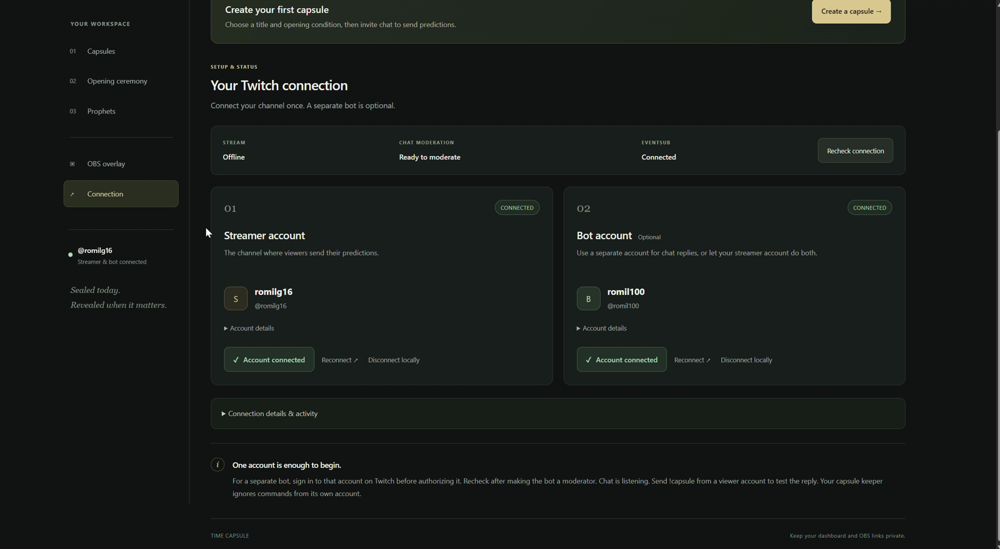

_Keep the streamer, bot, and viewer sessions separate._

### 2. Start the app — Phase 1

Use the existing server if it is running. Otherwise, run `npm run dev` from the cloned project folder. In the original WSL workspace, the commands are:

```sh
cd ~/hackathon_projects/time-capsule
export PATH="$PWD/.tools/node/bin:$PATH"
npm run dev
```

The `.tools/node` runtime is local to that workspace. If Node is already on your PATH, you can omit the `export` line. Leave the terminal running. Open `http://localhost:3000/health` and confirm the server and database report `ok`, then open the complete **Dashboard** URL printed in the terminal. Keep its private key out of the recording.

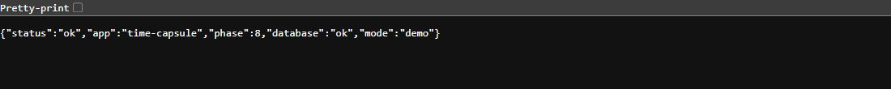

_The health check reports server and database status. This capture uses isolated demo mode._

### 3. Verify the accounts — Phase 2

Under **Connection**, confirm:

| Role     | Account  | Status    |
| -------- | -------- | --------- |
| Streamer | romilg16 | Connected |
| Bot      | romil100 | Connected |

If reconnecting, sign into the intended Twitch account before authorizing each role. As **romilg16**, send this in your own channel chat:

```text
/mod romil100
```

Click **Recheck connection**. Confirm **Ready to moderate** and **EventSub: Connected**. End any previous active ceremony before starting a new walkthrough.


_Both Twitch accounts are connected, with moderation and EventSub status visible._

### 4. Test chat — Phase 3

From **romiltest1**, send:

```text
hello Time Capsule
!capsule
```

Check **Connection details & activity → Channel activity** and the bot's reply. With no collecting capsule, “No capsule is open for sealing” is expected. Wait 30 seconds between repeated `!capsule` status checks.

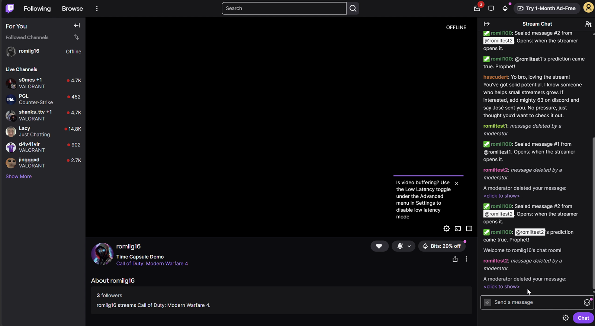

_Use this channel chat for viewer commands and check the bot replies._

### 5. Prepare OBS and the overlay

- In **OBS → Settings → Stream**, connect **romilg16**.
- Create a scene named **Time Capsule Demo**. Add a safe **Window Capture**, such as Notepad showing “Time Capsule Demo.” Playing a game is optional.
- In the dashboard's **OBS overlay** section, click **Copy OBS URL**. In OBS, add **Sources → + → Browser** named **Time Capsule Overlay**.

| Browser Source setting                    | Value                                         |
| ----------------------------------------- | --------------------------------------------- |
| URL                                       | Private overlay URL copied from the dashboard |
| Width × height                            | 1920 × 1080                                   |
| Shutdown source when not visible          | Off                                           |
| Refresh browser when scene becomes active | Off                                           |

Place the Browser Source above the background capture, with both eye icons visible. Click **Play 10-second preview** in the dashboard. Expect the opening and sample cards, followed by an empty, transparent overlay. You do not need to open the overlay URL in a browser first. Keep private dashboard pages, credentials, and keys out of the public stream.

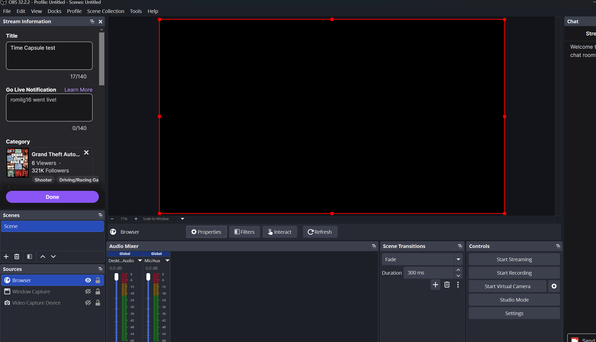

_The Browser Source is added to OBS. An idle transparent overlay can appear black when no background capture is visible._

### 6. Create the capsule — Phase 4

| Setting                  | Example value                                            |
| ------------------------ | -------------------------------------------------------- |
| Title                    | Our First Time Capsule                                   |
| Opening condition        | When I choose                                            |
| Seals per viewer         | 5                                                        |
| Maximum length           | 280                                                      |
| Reward Prophets with VIP | Enable for the VIP demo; leave off for basic recognition |
| VIP days                 | 30                                                       |

Click **Create & start collecting**. Confirm **SEALING** with zero messages. **Do not click Open now yet.** By default, a capsule allows 3 messages per viewer; this example raises that limit to 5. Each message needs 3–280 characters after `!seal`, with at least 10 seconds between accepted messages from the same viewer.

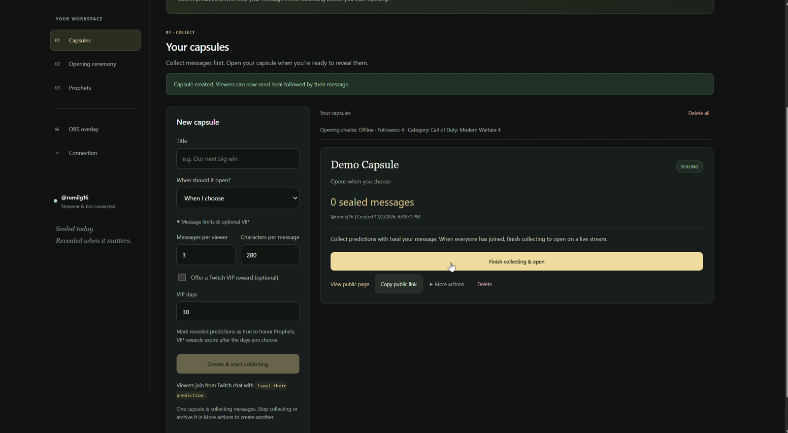

_A newly created capsule is collecting messages; opening comes after collection._

### 7. Send two predictions from romiltest1

```text
!seal I predict this message will appear on stream.
```

Wait at least **10 seconds**, then send:

```text
!seal I predict we will see a gold capsule opening.
```

Show the bot hiding the submissions and sending numbered confirmations. Messages can appear briefly before being hidden; broadcaster and moderator submissions cannot be hidden.


_The bot hides a viewer submission and confirms its seal number._

### 8. Send two messages from romiltest2

```text
!seal Hello to everyone watching this later.
```

Wait at least **10 seconds**, then send:

```text
!seal Reject this message for the moderation demonstration.
```

The capsule should now show **4 sealed messages**.


_The sealed-message count increases as viewers submit their messages._

### 9. Show the public page before opening

Click **View public page**. Show the title, opening condition, and count; sealed message contents remain hidden. Keep this page available for the final result.

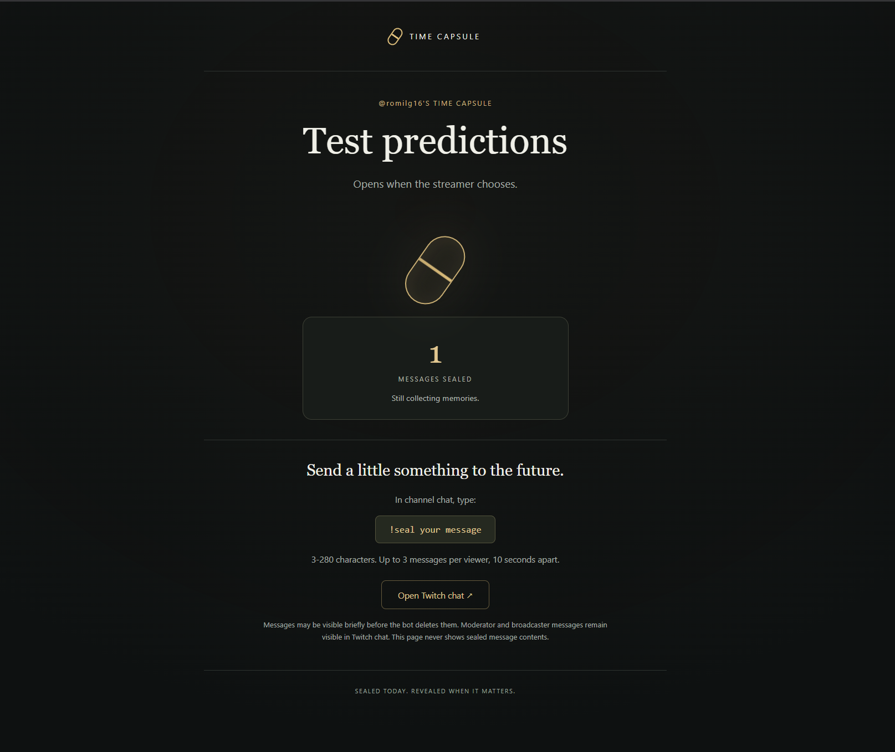

_Before opening, the public page shows the title and count while message contents stay hidden._

### 10. Start the live recording — Phase 5

Set the stream title to **Time Capsule — Live Demo** and choose **Just Chatting** or another available category. Use your safe background capture with the overlay above it.

- **Start Recording** saves a local video.
- **Start Streaming** broadcasts to Twitch. OBS can do both together.

Confirm **romilg16 is LIVE**. Click **Recheck connection** if the dashboard has not updated.

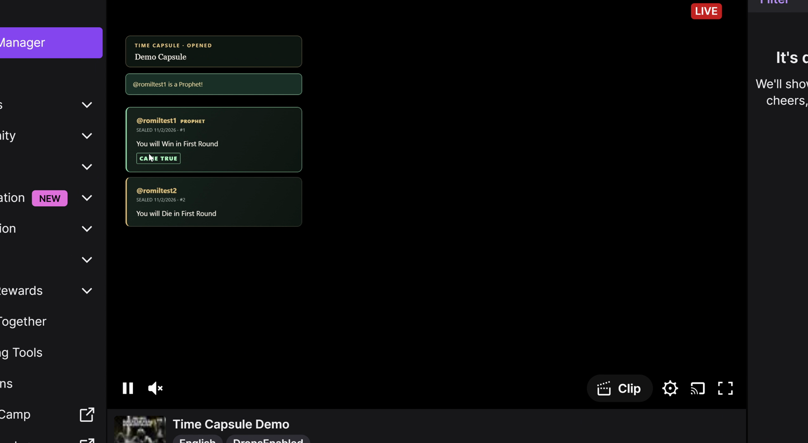

_Confirm the channel is live; the overlay appears over the broadcast when messages are revealed._

### 11. Open the capsule

While live, click **Open now once**. Allow approximately **5 seconds** of trigger delay, then **6 seconds** of opening animation. New seals are no longer accepted once the capsule is ready/opening.

If requested while offline, the capsule stays **READY** until you go live, then waits the configured settling delay (default **60 seconds**). A previous active ceremony must end before another capsule can open; the dashboard explains when it is queued.

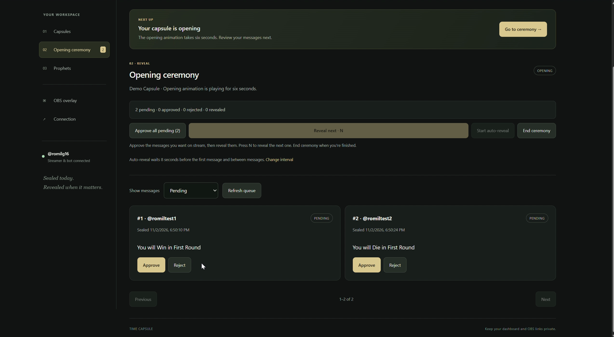

_After the opening finishes, the ceremony displays messages for moderation._

### 12. Approve and reveal — Phase 6

In **Opening ceremony**:

1. Approve **#1, #2, and #3**.
2. Reject **#4**.
3. Click **Reveal next** to show #1.
4. Click **Start auto-reveal** for the remaining approved messages.

Record the approved cards appearing in OBS. The rejected message must not appear. If **Pending** is empty, choose **Approved** or **All**. Auto-reveal follows the interval saved under **OBS overlay**. Keep the ceremony active for the next step.


_Approve the first three messages and reject the fourth before revealing._

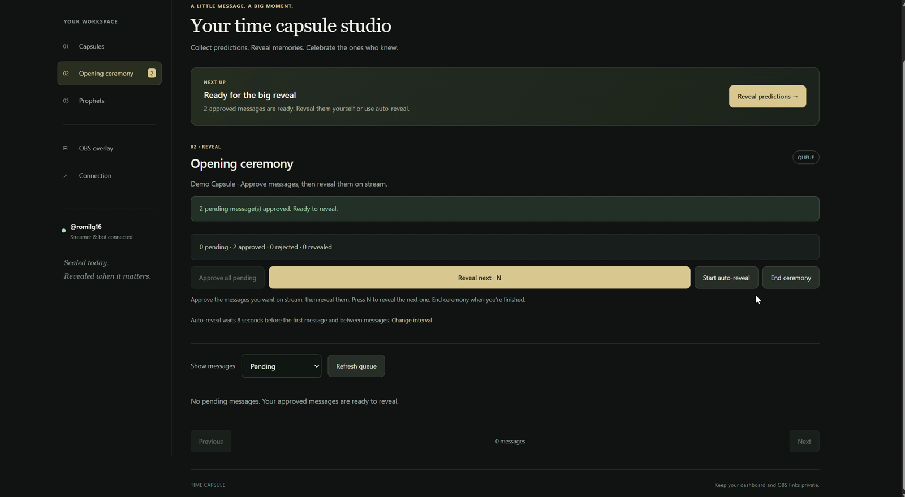

_Reveal approved messages manually or start auto-reveal._

### 13. Mark a prediction true — Phase 7

The prediction “this message will appear on stream” has now happened. In **Prophets**, find that prediction from **romiltest1** and click **Came true**. Show:

- The **PROPHET** badge and **CAME TRUE** stamp on the overlay.
- **romil100's** chat announcement mentioning **romiltest1**.
- If VIP was enabled, the confirmed reward and expiry, or the Twitch error.

VIP is optional and requires channel eligibility and an available slot. Prophet recognition still works if VIP is disabled or Twitch refuses the role.

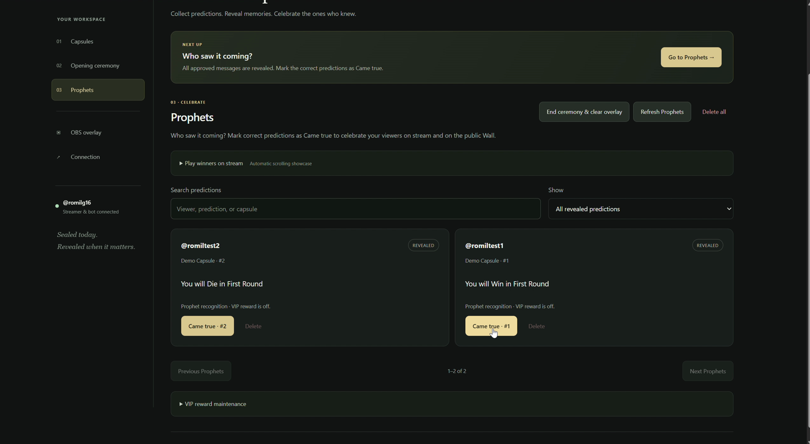

_Use Came true for a prediction that has been revealed and proven correct._

### 14. End the ceremony and show the public result

Click **End ceremony**. The capsule becomes **OPENED** and the overlay clears. Refresh the public capsule page: **romiltest1** appears on the **Wall of Prophets** with the revealed winning message. Other message contents stay private.

To replay winners afterward, select the completed capsule under **Prophets → Stream Prophet showcase**. Playback scrolls automatically and supports pause, next, and stop without repeating rewards or chat announcements.

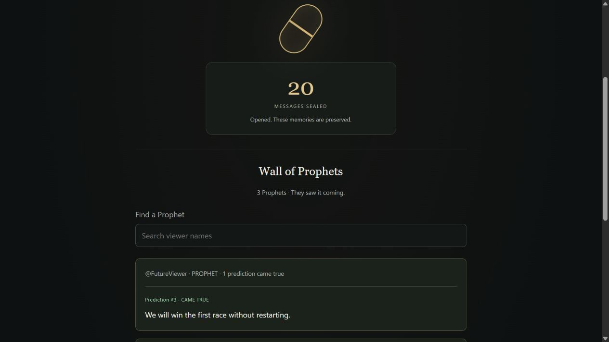

_After the ceremony, the public Wall includes Prophet names and their revealed winning predictions._

## Source, assets, and checks

All application source and required visual assets are included in this repository. On a fresh checkout, install **Node.js 20.19+ (24 recommended)** and npm, then run `npm ci` once before starting. Dependencies install from `package-lock.json`; no paid AI service or external media is needed at runtime.

| Location            | Contents                                                                    |
| ------------------- | --------------------------------------------------------------------------- |
| `src/`              | TypeScript server, SQLite migrations, Twitch integration, and isolated demo |
| `public/`           | Dashboard, public page, OBS overlay, and local demo artwork                 |
| `test/`             | Automated tests                                                             |
| `docs/screenshots/` | [Screenshots of the complete workflow](docs/screenshots/)                   |
| `.env.example`      | Configuration reference                                                     |

```sh
npm test
npm run typecheck
npm run lint
npm run build
npm start
```

`npm start` runs the compiled server after a build. Run one normal server at a time; stop it with **Ctrl+C** before starting another on port 3000. In Windows, use Linux Node/npm consistently inside WSL, or run both natively.

Normal mode saves capsules, account tokens, and private keys under `data/`; demo mode uses separate fresh storage under `data/demo/`. Keep `data/` across restarts and keep `.env`, tokens, and dashboard/overlay keys private. Temporary VIP expiry is processed while the app is running and at the next startup. Localhost public links work only on the host computer; hosting needs persistent storage, a reachable HTTPS `BASE_URL`, and a matching Twitch callback.

MIT license — see [LICENSE](LICENSE).
